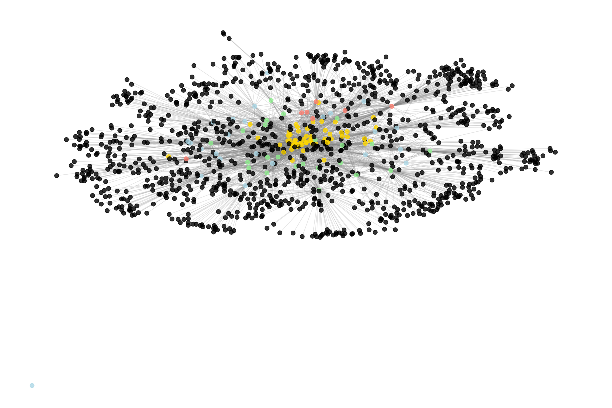
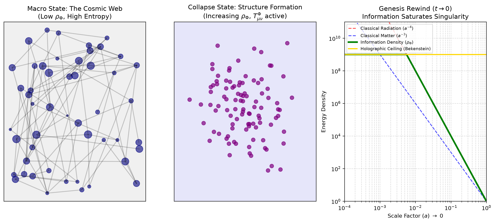
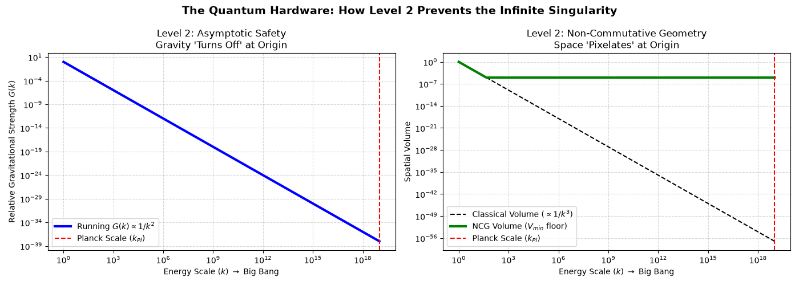
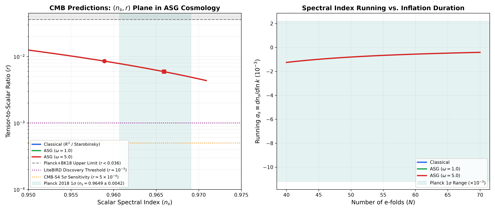

## The Resonance Cartographer

## Mapping the Information Singularity

An exploratory research project mapping resonances between mathematical topology, quantum gravity, and integrated information. The project connects a three-level equation dataset to a theoretical framework regarding the universe's earliest boundary conditions.

> - **Read the Version 2 Monograph:** View the expanded theoretical paper on the [Information Singularity, ASG, and CMB Predictions]({{ '/paper' | relative_url }}).
> - **Primordial CMB Predictions:** Testable tensor-to-scalar ratio $r \approx 0.0059 \ll 0.01$ and $n_s = 0.9659$ for [LiteBIRD & CMB-S4]({{ '/paper#5-primordial-cmb-observables-derivation--numerical-results' | relative_url }}).
> - **Topological Data Analysis (TDA) Report:** Read our detailed [TDA of Neural vs. Cosmic Networks]({{ '/tda-networks' | relative_url }}).
> - **Explore the data:** Visit the [topological map and verified seed crystals]({{ '/database' | relative_url }}).
> - **Follow the quantum biology bridge:** Compare [photosynthetic coherence and cosmological decoherence]({{ '/quantum-biology' | relative_url }}).
> - **Watch the generated film showcase:** Open [Resonance Cartography: The Holographic Descent]({{ '/assets/showcases/resonance-cartography/showcase.html' | relative_url }}).

## The Map

The project begins with 2,772 mathematical equations organized as a topological map across three levels of physical description:

1. **Fundamental physics**: particles, thermodynamics, and quantum ingredients.
2. **Advanced frameworks**: quantum-gravity approaches, including non-commutative geometry and asymptotic safety.
3. **Emergence and intelligence**: self-organizing cosmic structure and integrated information, $\Phi$.

From this map, 57 seed crystals persist across levels. Integrated information, $\Phi$, is the central candidate bridge.

## The Hypothesis

We explore a modified Friedmann equation in which information contributes to the stress-energy budget:

$$
H^2 = \frac{8\pi G}{3}(\rho_m + \rho_\Phi) + \frac{\Lambda}{3}.
$$

In the origin-limit model, classical matter is set to zero, leaving an information-dominated state:

$$
H^2 = \frac{8\pi G}{3}\rho_\Phi.
$$

Using Landauer's principle, $E = k_B T \ln 2$, and capping the thermodynamic temperature at the Planck temperature ($T_{\text{Pl}}$), the model translates this energy density into an information density: $\rho_\Phi = (\Phi \cdot k_B T_{\text{Pl}} \ln 2) / V$. This is a speculative theoretical framework, not an established cosmological model.

## The Genesis Rewind

The visual simulations explore whether a holographic ceiling can keep the information density finite as the scale factor approaches zero.

## Quantum Hardware

Two quantum-gravity frameworks provide the proposed limiting mechanisms:

- **Non-commutative geometry** imposes a minimum spatial volume ($V_{\text{min}} \approx \ell_P^3$), preventing the denominator of $\rho_\Phi$ from vanishing.
- **Asymptotic safety** makes Newton's constant scale-dependent, with $G(k) \to 0$ as the energy scale $k \to \infty$.

Together, these ideas motivate the synthesis:

$$
H^2(k) = \frac{8\pi G(k)}{3}\left(\frac{\Phi_{\max} k_B T_{\text{Pl}} \ln 2}{V_{\min}}\right).
$$

## Primordial CMB Predictions (LiteBIRD & CMB-S4)

Because Asymptotic Safety enforces $G(k) \to 0$ at trans-Planckian energies, tensor modes (primordial gravitational waves) are suppressed by quantum gravitational antiscreening. At $N = 60$ e-folds, our framework predicts:

- **Tensor-to-Scalar Ratio:** $r \approx 0.0059 \ll 0.01$ (well below current Planck limits $r < 0.036$, falling directly into LiteBIRD's discovery window).
- **Scalar Spectral Index:** $n_s \approx 0.9659$ (consistent with Planck 2018: $0.9649 \pm 0.0042$).
- **Running:** $\alpha_s \approx -5.56 \times 10^{-4}$.

The question posed here is whether the Big Bang can be usefully modeled as a finite information boundary rather than an infinite material singularity.

## Repository Contents

- `equations.jsonl`: the equation map used in the exploration.
- `seed_crystals.json`: variables that recur across all three levels.
- `singularity_rewind.py`: symbolic derivation of the information-dominated origin state.
- `holographic_ceiling.py`, `quantum_hardware.py`, and `build_reverse_time.py`: visualization scripts.

## Scope

This repository records an independent, AI-assisted theoretical investigation. The accompanying paper has undergone rigorous AI-driven peer review, but its equations and visualizations should be treated as exploratory theoretical physics rather than empirically verified scientific conclusions.
